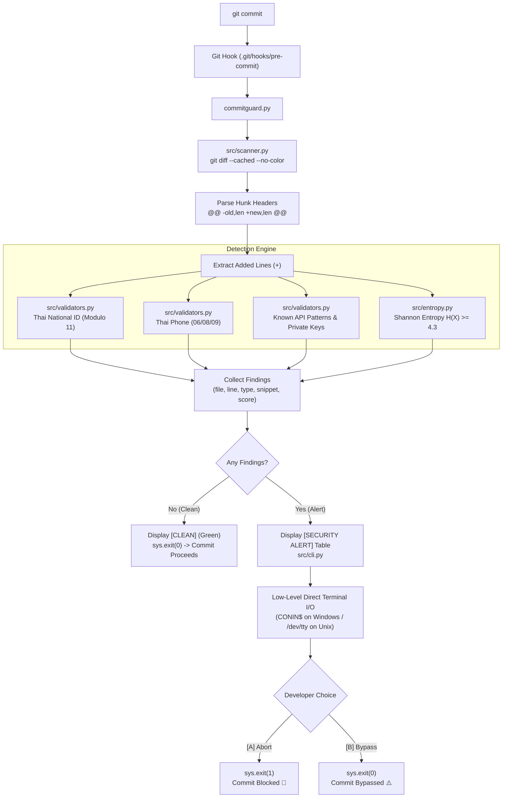

# CommitGuard 🛡️

**DevSecOps Git Pre-commit Secret & PII Shield**

CommitGuard คือเครื่องมือ Git Pre-commit Hook CLI น้ำหนักเบาสำหรับสกัดจับข้อมูลส่วนบุคคล (PII เช่น เลขประจำตัวประชาชนไทย, เบอร์โทรศัพท์) และ High-Entropy Secrets (API Keys, Private Keys) จาก `git diff --cached` ก่อนที่นักพัฒนาจะ Commit โค้ดเข้าสู่ Repository

> **Zero Third-Party Dependencies:** พัฒนาด้วยภาษา **Python Standard Library 100%** ไม่ต้องติดตั้งไลบรารีภายนอก ไม่ต้องรัน `pip install` สามารถทำงานได้ทันทีบนทุกเครื่อง (Cross-Platform: Windows, Linux, macOS)

---

## 📑 สารบัญ (Table of Contents)

1. [ภาพรวมโครงการ (Project Overview)](#-ภาพรวมโครงการ-project-overview)
2. [สถาปัตยกรรมระบบ (System Architecture)](#-สถาปัตยกรรมระบบ-system-architecture)
3. [ทฤษฎีทางคณิตศาสตร์และวิทยาการคอมพิวเตอร์](#-ทฤษฎีทางคณิตศาสตร์และวิทยาการคอมพิวเตอร์)
   - [ทฤษฎี Shannon Entropy](#1-ทฤษฎี-shannon-entropy-ความสับสนสถิติของข้อมูล)
   - [ทฤษฎี Modulo 11 Checksum (Thai National ID)](#2-ทฤษฎี-modulo-11-checksum-เลขบัตรประชาชนไทย-13-หลัก)
4. [วิศวกรรมระดับ Low-Level OS: Direct Terminal I/O](#-วิศวกรรมระดับ-low-level-os-direct-terminal-io)
5. [การติดตั้งและคำสั่งใช้งาน (Installation & Usage)](#-การติดตั้งและคำสั่งใช้งาน-installation--usage)
6. [โครงสร้างโปรเจกต์ (Project Structure)](#-โครงสร้างโปรเจกต์-project-structure)
7. [การทดสอบ Unit Tests](#-การทดสอบ-unit-tests)

---

## 🎯 ภาพรวมโครงการ (Project Overview)

ปัญหาข้อมูลความลับรั่วไหล (Credential Leakage) สู่ Public/Private Git Repositories มักเกิดจากความเผลอเรอของนักพัฒนาที่ Hardcode API Keys หรือข้อมูลทดสอบ (PII) ลงในโค้ด

**CommitGuard** ยึดหลักการความปลอดภัยแบบ **Shift-Left Security** โดยเข้าแทรกแซงในจังหวะ Pre-commit ของ Git เพื่อ:
- ตรวจจับเฉพาะบรรทัดที่มีการเปลี่ยนแปลงจริงใน Staging Area (`git diff --cached`)
- สกัดจับ PII ตามบริบทประเทศไทย (เลขบัตรประชาชน 13 หลัก, เบอร์โทรศัพท์มือถือ)
- ค้นหาลายเซ็น API ยอดนิยม (AWS, OpenAI, GitHub PAT, Private Keys)
- วิเคราะห์ความสุ่มของสตริงด้วย Shannon Entropy เพื่อตรวจจับคีย์หรือโทเค็นที่ไม่ตรงกับ Regex รูปแบบเดิม
- เปิดโอกาสให้นักพัฒนาตัดสินใจแก้ไข (`[A] Abort`) หรือข้ามการตรวจสอบ (`[B] Bypass`) ได้สดๆ บน Terminal

---

## 🏗️ สถาปัตยกรรมระบบ (System Architecture)

CommitGuard แบ่งออกเป็นโมดูลที่ทำงานสอดประสานกันเป็น Pipeline ดังนี้:



---

## 🧮 ทฤษฎีทางคณิตศาสตร์และวิทยาการคอมพิวเตอร์

### 1. ทฤษฎี Shannon Entropy (ความสับสน/สถิติของข้อมูล)

พัฒนาโดย **Claude E. Shannon** ในปี 1948 (*A Mathematical Theory of Communication*) เพื่อวัดปริมาณความไม่แน่นอน (Uncertainty) หรือข้อมูลเฉลี่ยที่บรรจุอยู่ในตัวแปรสุ่ม มีสูตรทางคณิตศาสตร์คือ:

$$H(X) = -\sum_{i=1}^{n} P(x_i) \log_2 P(x_i)$$

โดยที่:
- $n$: จำนวนตัวอักษรที่ไม่ซ้ำกันในสตริง (Distinct Characters)
- $P(x_i)$: ความถี่สัมพัทธ์ (Probability) ของตัวอักษร $x_i$ ในสตริง
- $\log_2$: ลอการิทึมฐานสอง ทำให้ผลลัพธ์มีหน่วยเป็น **bits per character**

#### การประยุกต์ใช้ในการตรวจจับกุญแจความลับ (Secrets Detection)
- **ข้อความภาษาอังกฤษทั่วไป / โค้ดโปรแกรม:** ตัวอักษรจะมีความถี่กระจุกตัวตามไวยากรณ์ (เช่น ตัวอักษร `e`, `t`, `a` พบบ่อยมาก) ส่งผลให้ค่า Entropy ต่ำ อยู่ที่ประมาณ **$2.0 - 3.5$ bits/char**
- **Cryptographic Keys / API Tokens:** ผลิตจาก Random Number Generator ทำให้การกระจายตัวของตัวอักษรมีความสุ่มสูงมาก (High Entropy) เช่น Base64 หรือ Hex strings ขนาดยาว จะมีค่า Entropy สูงถึง **$4.3 - 5.5+$ bits/char**

#### กลยุทธ์การลด False Positive ใน CommitGuard:
1. **Length Filtering:** กรองเฉพาะ Token ที่มีความยาว $\ge 16$ ตัวอักษร (คำสั้นๆ แม้จะกระจายตัวสม่ำเสมอก็จะไม่ถูกตีความเป็น Secret)
2. **Threshold Tuning:** กำหนดจุดตัดค่าเอนโทรปีมาตรฐานที่ **$4.3$ bits/char**

---

### 2. ทฤษฎี Modulo 11 Checksum (เลขบัตรประชาชนไทย 13 หลัก)

เลขประจำตัวประชาชนไทย 13 หลักตามมาตรฐานกระทรวงมหาดไทย ประกอบด้วยเลข 13 หลัก ($d_1 d_2 d_3 \dots d_{12} d_{13}$) โดยหลักสุดท้าย ($d_{13}$) คือ **Check Digit** ที่คำนวณผ่านขั้นตอนวิธี **Modulo 11**:

#### ขั้นตอนวิธีคำนวณ:
1. นำเลข 12 หลักแรกแต่ละหลักมาคูณกับค่าถ่วงน้ำหนัก (Weight) เริ่มต้นจาก 13 ลดหลั่นลงไปจนถึง 2:
   $$\text{Sum} = \sum_{i=0}^{11} d_i \times (13 - i) = (d_0 \times 13) + (d_1 \times 12) + \dots + (d_{11} \times 2)$$
2. คำนวณหาเศษเหลือจากการหารด้วย 11:
   $$R = \text{Sum} \pmod{11}$$
3. คำนวณหา Check Digit ด้วยการลบเศษออกจาก 11 แล้วนำไป Modulo ด้วย 10:
   $$\text{Check Digit} = (11 - R) \pmod{10}$$
4. ตรวจสอบความถูกต้อง: ค่าที่คำนวณได้ต้องเท่ากับตัวเลขในหลักที่ 13 ($d_{12}$) พอดี
5. **Identical Digits Check:** กรองกรณีเลขที่ซ้ำกันทั้งหมด 13 หลัก (เช่น `1111111111111`) ซึ่งแม้จะตรงตามสูตรคำนวณแต่ไม่ใช่เลขจริง

---

## 💻 วิศวกรรมระดับ Low-Level OS: Direct Terminal I/O

### ปัญหาของ Git Hook ในระบบปฏิบัติการ
เมื่อ Git เรียกใช้งาน Pre-commit Hook (เช่น ผ่าน `git commit`) Git จะทำการ Redirect สตรีมอินพุตมาตรฐาน (`sys.stdin`) เพื่อส่งข้อมูลหรือป้องกันไม่ให้ Hook ไปรบกวนกระบวนการ commit ส่งผลให้คำสั่งอ่านค่าจากแป้นพิมพ์ทั่วไป เช่น `input()` ในภาษา Python เกิดข้อผิดพลาด `EOFError: EOF when reading a line` หรือทำงานไม่ถูกต้อง

### วิธีการแก้ไขใน CommitGuard
CommitGuard ทำการข้าม `sys.stdin` และเชื่อมต่อไปยังตัวควบคุมอุปกรณ์ Terminal ประจำโพรเซสโดยตรง (Controlling Terminal Device):
- **Windows:** เปิดสตรีมเชื่อมต่อตรงไปยังไดรเวอร์คอนโซล `CONIN$`
- **Linux / macOS:** เปิดสตรีมเชื่อมต่อตรงไปยังอุปกรณ์ `/dev/tty`

```python
tty_path = 'CONIN$' if os.name == 'nt' else '/dev/tty'
with open(tty_path, 'r', encoding='utf-8') as tty:
    choice = tty.readline().strip().upper()
```

> **Fail-Safe Mechanism:** ในกรณีที่ระบบทำงานบน CI/CD Pipeline (Non-interactive mode) ที่ไม่มี Terminal Controller ระบบจะส่งสัญญาณ `sys.exit(1)` ทันที เพื่อป้องกันไม่ให้ความลับหลุดรอดออกไป

---

## 🚀 การติดตั้งและคำสั่งใช้งาน (Installation & Usage)

### 1. ติดตั้งแบบคำสั่งเดียว (One-Command Install)

#### สำหรับ Windows:
ดับเบิลคลิกไฟล์ `install.bat` หรือรันผ่าน Command Prompt:
```cmd
install.bat
```

#### สำหรับ Linux / macOS:
```bash
chmod +x install.sh
./install.sh
```

#### ผ่าน Python CLI โดยตรง:
```bash
python commitguard.py --install
```
คำสั่งจะสร้างไฟล์ `.git/hooks/pre-commit` และตั้งสิทธิ์ `chmod +x` (0755) ให้อัตโนมัติ

---

### 2. คำสั่ง CLI ทั้งหมด

| คำสั่ง | คำอธิบาย |
| :--- | :--- |
| `python commitguard.py --install` | ติดตั้ง CommitGuard ลงใน `.git/hooks/pre-commit` ของ Repository ปัจจุบัน |
| `python commitguard.py --scan` | สแกนไฟล์ที่ถูก Stage (`git add`) ทันทีโดยไม่ต้องสั่ง Commit |
| `python commitguard.py --uninstall` | ถอนการติดตั้ง CommitGuard ออกจาก Git Hook |
| `python commitguard.py --help` | แสดงคู่มือและคำอธิบายคำสั่งช่วยเหลือ |

---

## 📁 โครงสร้างโปรเจกต์ (Project Structure)

```text
CommitGuard/
├── commitguard.py         # Entrypoint หลักของโปรแกรมและ Argument Dispatcher
├── install.sh             # สคริปต์ติดตั้งอัตโนมัติสำหรับ Linux และ macOS
├── install.bat            # สคริปต์ติดตั้งอัตโนมัติสำหรับ Windows
├── src/
│   ├── __init__.py        # แพ็กเกจโมดูล
│   ├── entropy.py         # ฟังก์ชัน Shannon Entropy H(X) และ High-Entropy Detector
│   ├── validators.py      # Modulo 11 Thai ID และ Regex Scanners (Phone, API Keys, Pem)
│   ├── scanner.py         # Hunk Diff Parser และตัวแยก Added Lines จาก git diff --cached
│   └── cli.py             # จัดการ ANSI Display, Direct Terminal I/O, และ Hook Installer
├── tests/
│   ├── __init__.py
│   ├── test_core.py       # Unit Tests สำหรับ Entropy & Validators (16 Tests)
│   └── test_scanner.py    # Unit Tests สำหรับ Diff Parser, CLI & Mock Workflows (8 Tests)
└── README.md              # เอกสารและคู่มือการใช้งานโครงการ
```

---

## 🧪 การทดสอบ Unit Tests

ชุดทดสอบทั้งหมดทำงานผ่านโมดูล `unittest` ใน Python Standard Library:

```bash
python -m unittest discover -s tests -v
```

### สรุปผลการทดสอบ (24 Tests Passed):
- ✅ **Shannon Entropy:** Empty string, Single char, Uniform distribution, Random keys
- ✅ **Thai ID Modulo 11:** Valid IDs, Formatted with hyphens, Invalid checksum, Identical digits
- ✅ **Regex Scanners:** Thai phones (06x, 08x, 09x), Private keys (RSA/EC/SSH), AWS Keys, OpenAI Keys, GitHub PATs
- ✅ **Diff Parser:** Hunk parsing, Line number tracking, Additions isolation, Clean diffs
- ✅ **CLI Workflows:** Snippet masking, Abort [A] exit code 1, Bypass [B] exit code 0, Clean diff exit code 0
